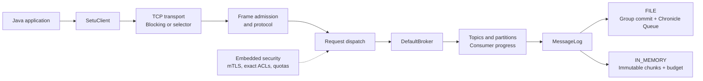

# Setu

**A single-node Java message broker with partitioned logs and durable acknowledgements.**

[](https://github.com/RishabhRathi-Dev/Setu/actions/workflows/ci.yml)
[](pom.xml)
[](.mvn/wrapper/maven-wrapper.properties)

[Quick start](#quick-start) · [Documentation](docs/README.md) · [Examples](examples/README.md) · [Contributing](CONTRIBUTING.md) · [Get help](SUPPORT.md)

Setu stores ordered records in topic partitions and exposes explicit produce, fetch, and consumer-progress operations. The default `FILE` engine uses OpenHFT Chronicle Queue; `IN_MEMORY` provides bounded, volatile storage. The implementation includes blocking and selector TCP transports, synchronous and bounded async Java clients, managed groups, identified producer retries, single-partition transactions, and an embedded mTLS security pipeline.

Setu is under active development. It runs as one broker process, with no replication or failover. File brokers recover active consumer memberships and acknowledged progress; security policies remain process-local. See [implementation boundaries](#implementation-boundaries) before choosing a deployment model.

## At a glance

- **Partitioned messaging:** explicit partition selection, ordered offsets, batch produce, and long-poll fetch.
- **Two storage modes:** durable daily Chronicle logs with group commit and optional file retention, or bounded memory with consumer-driven reclamation.
- **Recovery and processing:** managed-group generation fencing, idempotent producers, atomic consume/produce, and checksummed metadata checkpoints.
- **Java integration:** synchronous and bounded async clients, a PostgreSQL outbox/inbox adapter, and an embeddable broker.
- **Operations:** [Docker and Compose](docs/containers.md), loopback Prometheus metrics/readiness, [LGTM collection and propagated request traces](docs/observability.md), automatic journal compaction, and packaged distributions.
- **Embedded security:** mTLS identities, default-deny exact ACLs, and per-principal request/byte quotas.
- **Measured behavior:** functional TCP/mTLS tests, recovery and chaos checks, and benchmark reports that retain qualification failures.

The [recovery demo](examples/recovery-demo/README.md) exercises transaction retries and process-crash recovery. Run `python examples/recovery-demo/run.py` with JDK 26 and Python 3.10+. It drops a committed transaction reply, retries, checkpoints, forcibly terminates the broker, and verifies one output and the recovered input offset. Logs, metrics and environment evidence are saved in a fresh local directory.

## Contents

- [Quick start](#quick-start)
- [Architecture](#architecture)
- [Messaging and storage](#messaging-and-storage)
- [Security](#security)
- [Configuration](#configuration)
- [Build and verification](#build-and-verification)
- [Repository guide](#repository-guide)
- [Implementation boundaries](#implementation-boundaries)
- [Performance](#performance)
- [Help and contributions](#help-and-contributions)

## Quick start

### Containers

Build and start the broker with JDK 26 included:

```text
docker compose up --build -d
```

For Grafana, Loki, Tempo, Mimir and Alloy, use `docker compose -f compose.yaml -f compose.lgtm.yaml up --build -d`. [Container setup](docs/containers.md) covers client examples inside the image, CI-aligned resource limits, persistent storage, health checks and the [published-image workflow](.github/workflows/container.yml).

The native setup follows for development with a host JDK.

### 1. Build and start the broker

Install **JDK 26**, set `JAVA_HOME` to its directory, and add its `bin/` directory to `PATH`. The Maven Wrapper downloads the pinned Maven distribution on first use; no separate Maven installation is required. Run these commands from the repository root.

**Windows / PowerShell**

```powershell
.\mvnw.cmd -pl setu-server -am package
.\scripts\start-broker.ps1 --config config/server.properties
```

**Linux / macOS**

```bash
bash ./mvnw -pl setu-server -am package
bash ./scripts/start-broker.sh --config config/server.properties
```

Wait for `Setu listening on` in the console. Defaults are plaintext **127.0.0.1:9092**, durable data in `data/`, and rolling logs in `logs/`. Ctrl+C closes connections and drains accepted storage writes. Keep the JAR and its adjacent `setu-server/target/lib/` dependencies together.

Both launchers load [config/jvm.options](config/jvm.options), including ZGC, string deduplication, and Chronicle's module/native access. [Operations](docs/operations.md) covers direct JAR launches, logging, shutdown, recovery, and optional AOT training.

### 2. Produce and consume records

In a second terminal, run the checked-in [Java example](examples/SetuQuickstart.java). The command works in PowerShell and Bash with JDK 26 on `PATH`:

```powershell
java '@config/jvm.options' -cp 'setu-server/target/lib/*' examples/SetuQuickstart.java
```

On a fresh topic, it prints:

```text
0: hello, Setu
1: ordered by partition
```

The example creates a topic, joins a consumer group, appends a batch, fetches it, acknowledges the next offset, and leaves the group. It can be rerun; offsets increase in durable mode. Optional arguments select a host and port. Use a dedicated local broker while running it.

To use Setu in an application, [install the client modules locally and add the Maven dependency](setu-client/README.md#add-to-a-maven-application). The client guide also documents error handling, TLS, timeouts, and ownership.

## Architecture



Transport manages sockets and buffer admission; core owns protocol and broker semantics; storage maps logical offsets to physical records. The embedded secure server authenticates connections and authorizes requests before dispatch. The standalone properties launcher serves plaintext.

The [architecture guide](docs/architecture.md) includes module dependencies, a durable-write sequence, consumer lifecycle, backpressure, and restart behavior. The [wire reference](setu-core/README.md#protocol) describes framing and command IDs.

## Messaging and storage

Records are opaque byte arrays. Ordering and dense, zero-based offsets apply **within each partition**. Applications select partitions explicitly. Batch produce returns the first assigned offset; fetch returns whole records within a byte budget. Consumer acknowledgements use the next offset after the last processed record.

| Behavior | `FILE` (default) | `IN_MEMORY` |
| --- | --- | --- |
| Engine | Chronicle Queue 2026.7 with bounded group commit | Immutable chunks published with CAS |
| Successful produce | Touched queue and metadata files have completed the force boundary | Complete batch published in memory |
| Restart | Topics and records recover from disk | Topics and records are lost |
| Consumer join | Starts at offset zero | Starts at the current partition end |
| Reclamation | Optional age-based retention of completed daily files | Slowest registered member's progress; no members allows immediate reclamation |
| Primary admission | 32 MiB / 1,024 outstanding writes per partition | Shared 256 MiB accounted retained-log budget |

In memory mode, **join before producing records a member needs**. Acknowledgement, leaving, and member expiry can release retained prefixes. Optional timed expiry is lossy and disabled by default. Buffer budgets are separate from retained-log admission and do not cap total process memory.

A failed or lost produce reply has an uncertain outcome; retrying can duplicate records. Read the [storage guide](setu-storage/README.md) for force semantics, recovery, ownership, admission, and [legacy migration](setu-storage/README.md#migrating-existing-data).

## Security

`SecureServerFactory` composes JSSE TLS/mTLS, DNS SAN client identity, default-deny exact ACL grants, and per-principal request/byte quotas. TLS clients verify the broker hostname. Security policies are configured by the embedding application.

Use the [secure server example](setu-server/README.md#secure-broker-wiring-example) and [security reference](setu-security/README.md) to configure this path. Development certificate generators are available for [PowerShell](scripts/generate-certs.ps1) and [Bash](scripts/generate-certs.sh); generated keys and stores stay outside version control. Selector transport supports plaintext only.

## Configuration

The standalone launcher accepts `--config <properties-file>`. Unknown properties fail startup; paths are relative to the launch working directory.

| Setting | Default | Purpose |
| --- | --- | --- |
| `storage.mode` | `FILE` | `FILE` or `IN_MEMORY` |
| `transport` | `blocking` | Virtual thread per connection, or plaintext `selector` |
| `record.max.bytes` | 1 MiB | Maximum payload per record |
| `queue.block.bytes` | 64 MiB | Chronicle mapping block size; does not limit file growth |
| `file.retention.millis` | `0` | Expire completed daily files by age; zero disables retention |
| `memory.log.max.bytes` | 256 MiB | Shared accounted retained-log budget |
| `requests.max.bytes` / `responses.max.bytes` | 128 MiB each | Shared transport buffer budgets |
| `consumers.max` / `consumer.partitions.max` | 10,000 / 100,000 | Active member and summed partition membership admission |
| `socket.timeout.millis` / `handshake.timeout.millis` / `frame.timeout.millis` | 60,000 / 10,000 / 30,000 | Idle/read, absolute setup and whole-frame deadlines |
| `ack.timeout.millis` / `consumer.timeout.millis` | 30,000 / 60,000 | Consumer progress and inactivity deadlines |

See the [complete configuration reference](docs/configuration.md) for all properties, units, validation, and runtime options, including [file retention examples](docs/configuration.md#file-retention-examples). The checked-in [server.properties](config/server.properties) is the local-development baseline.

## Build and verification

Run production-module and real TCP/mTLS integration tests:

```powershell
.\mvnw.cmd -pl setu-integration-tests -am test
```

On Linux/macOS, substitute `bash ./mvnw`. Python 3.10+ is required for the benchmark tooling and its tests:

```bash
python -m unittest discover -s scripts -p 'test_*.py'
```

CI also runs Windows functional tests and [a source security gate](.github/workflows/security.yml). Benchmark-helper tests, bounded chaos, load checks, baseline/target measurements, and AOT validation are covered by [CI](.github/workflows/ci.yml). The root Maven reactor includes benchmark workloads; use the commands above for ordinary functional verification. [Contributing](CONTRIBUTING.md) documents the broader verification matrix and repository conventions.

## Repository guide

| Path | Responsibility / documentation |
| --- | --- |
| [setu-core/](setu-core/README.md) | Broker API, topics, partitions, membership, and protocol codec |
| [setu-storage/](setu-storage/README.md) | Partition logs, group commit, recovery, and migration |
| [setu-server/](setu-server/README.md) | TCP transports, secure dispatch, standalone launcher, and AOT |
| [setu-client/](setu-client/README.md) | Synchronous and bounded async Java clients, plaintext and TLS |
| [setu-security/](setu-security/README.md) | Authentication, exact ACLs, certificates, and quotas |
| [setu-integration-tests/](setu-integration-tests/README.md) | Functional verification over real sockets |
| [setu-benchmark/](setu-benchmark/README.md) | Throughput, latency, JFR, crash recovery, and chaos |
| [docs/](docs/README.md) | Architecture, configuration, and operations guides |
| [AGENTS.md](AGENTS.md) | Repository knowledge base, source entry points, invariants, and agent verification guidance |
| [scripts/](scripts/README.md) | Launch, certificate, profiling, reporting, and diagnostic tools |
| [examples/](examples/README.md) | Runnable clients, batch/partition fetches, long polling, embedded brokers, recovery and retention |
| [config/](config/server.properties) | Server properties, JVM flags, and Logback configuration |
| [benchmark-badges/](benchmark-badges/node-target-results.json) | CI-maintained SVGs and measurement snapshots |

Generated builds, IDE metadata, runtime data, credentials, logs, and recordings are ignored. Published benchmark snapshots remain tracked because CI uses them to update the README.

## Implementation boundaries

- One broker process; no replication, failover, or distributed coordination.
- File brokers recover memberships and acknowledged progress. Memory brokers lose them on restart. Leave and expiry remove progress in both modes.
- FILE brokers offer opt-in managed assignment/rebalancing, producer deduplication and single-input/single-output-partition transactions. Producer sequencing and external effects still require application coordination; see [transaction guarantees and limits](docs/transactions.md).
- New durable documents carry CRC32C checksums; older documents remain readable without checksum protection. Per-request `DURABLE` (default) and weaker `ACCEPTED` acknowledgement modes are available.
- `SetuClient` serializes calls. `AsyncSetuClient` adds bounded pooling, keyed routing, reconnects and retries for reads and identified transactional/idempotent writes. Ordinary writes retain uncertain retry outcomes.
- Metadata checkpoints compact historical transaction payloads while preserving fencing and progress. They pause broker requests; producer/group deletion and incremental snapshots remain unsupported. See [checkpoint recovery and compatibility](docs/journal-checkpoints.md).
- ACL grants and quotas are process-local; persistent policy administration and automatic certificate rotation are not implemented.

The [PostgreSQL outbox/inbox adapter](docs/postgres-outbox.md) supports transactional publication intent and deduplicated database effects. Outbox publication may repeat; its PostgreSQL transaction is separate from Setu's broker transaction boundary.

## Performance

Reference targets are **500,000 records/s in memory** and **250,000 records/s durable**, with 1 KiB records. These are qualification goals. A completed run must also satisfy consumption, latency, CPU, heap, and error criteria. A smoke run or an unqualified result does not establish sustained capacity.

The [benchmark guide](setu-benchmark/README.md) documents reproducible profiles, strict/report-only policies, host budgets, and JFR interpretation. Results from a different storage engine do not qualify Chronicle Queue.

The generated blocks below retain their source revision, host information, and qualification status. Read them against that revision rather than as measurements of the current checkout; CI refreshes them after new runs.

### CI benchmarks

The badges and expandable report below come from resource-enforced CI runs. Contributor PC diagnostics follow in their own section. CI publication continues when the contributor attachment check fails; that check still reports its failure separately.

<!-- benchmark-metrics-badges:start -->
[](https://github.com/RishabhRathi-Dev/Setu/actions/runs/40927196794)
[](https://github.com/RishabhRathi-Dev/Setu/actions/runs/40927196794)
<!-- benchmark-metrics-badges:end -->

<details>
<summary>Latest CI target diagnostics and qualification details</summary>

<!-- benchmark-target-diagnostics:start -->
[](https://github.com/RishabhRathi-Dev/Setu/actions/runs/40927196794)
[](https://github.com/RishabhRathi-Dev/Setu/actions/runs/40927196794)
[](https://github.com/RishabhRathi-Dev/Setu/actions/runs/40927196794)
[](https://github.com/RishabhRathi-Dev/Setu/actions/runs/40927196794)
[](https://github.com/RishabhRathi-Dev/Setu/actions/runs/40927196794)
[](https://github.com/RishabhRathi-Dev/Setu/actions/runs/40927196794)
<!-- benchmark-target-diagnostics:end -->

<!-- benchmark-capacity-details:start -->
Latest source: **CI**, revision `4e65282832d61710fa5e7b898842ab3f16d7386d`. [Benchmark run/report](https://github.com/RishabhRathi-Dev/Setu/actions/runs/40927196794).

Runner: Intel(R) Xeon(R) 6973P-C; 4.0 enforced CPU cores; 128 MiB worker heap; filesystem/media /dev/nvme0n1p1 ext4 (non-rotational).

Runner: AMD EPYC 9V45 96-Core Processor; 4.0 enforced CPU cores; 256 MiB worker heap; filesystem/media /dev/nvme0n1p1 ext4 (non-rotational).

# Node-target measurements

Three independent repetitions; 1 KiB records; 10s or longer warmup and 30s measurement at 50%, 80% and 100% of target. File acknowledgments follow force of every touched segment. Health requires 95% consumption and offered throughput, zero errors, HDR p99 within mode/load limits, CPU <=85% of the allocated budget, heap <=1 GiB and heap slope <=1 MiB/s. CPU qualification is evaluated before display rounding; CPU percentages show four decimal places.

Writes count unique records; each record needs one delivery in this workload. Write target achieved compares actual writes with requested writes. Delivery coverage compares unique deliveries with completed writes in the same window. Similar write and delivery rates do not guarantee the requested load or other limits were met.

| Mode | Reference writes/s | Median actual writes/s | Write target achieved | Worst target p99 ms | Peak heap MiB | Peak average CPU % | Qualified |
| --- | ---: | ---: | ---: | ---: | ---: | ---: | --- |
| IN_MEMORY | 500,000 | 499,994 | 100.0% | 0.308 | 256 | 39.0659 | True |
| FILE | 250,000 | 172,851 | 69.1% | 10812.916 | 126 | 37.6323 | False |

**Fixed-target traffic**

| Mode | Repeat | Requested writes/s | Actual writes/s | Unique deliveries/s | Write target achieved | Delivery coverage |
| --- | ---: | ---: | ---: | ---: | ---: | ---: |
| FILE | 1 | 125,000 | 124,996 | 125,030 | 100.0% | 100.0% |
| FILE | 1 | 200,000 | 163,209 | 156,339 | 81.6% | 95.8% |
| FILE | 1 | 250,000 | 173,184 | 149,419 | 69.3% | 86.3% |
| FILE | 2 | 125,000 | 124,996 | 125,022 | 100.0% | 100.0% |
| FILE | 2 | 200,000 | 171,153 | 151,987 | 85.6% | 88.8% |
| FILE | 2 | 250,000 | 159,104 | 158,925 | 63.6% | 99.9% |
| FILE | 3 | 125,000 | 124,996 | 125,013 | 100.0% | 100.0% |
| FILE | 3 | 200,000 | 172,279 | 151,509 | 86.1% | 87.9% |
| FILE | 3 | 250,000 | 172,851 | 148,608 | 69.1% | 86.0% |
| IN_MEMORY | 1 | 250,000 | 249,993 | 250,018 | 100.0% | 100.0% |
| IN_MEMORY | 1 | 400,000 | 400,000 | 400,017 | 100.0% | 100.0% |
| IN_MEMORY | 1 | 500,000 | 499,994 | 500,002 | 100.0% | 100.0% |
| IN_MEMORY | 2 | 250,000 | 249,993 | 249,950 | 100.0% | 100.0% |
| IN_MEMORY | 2 | 400,000 | 400,000 | 400,009 | 100.0% | 100.0% |
| IN_MEMORY | 2 | 500,000 | 499,994 | 500,002 | 100.0% | 100.0% |
| IN_MEMORY | 3 | 250,000 | 249,993 | 250,001 | 100.0% | 100.0% |
| IN_MEMORY | 3 | 400,000 | 400,000 | 400,017 | 100.0% | 100.0% |
| IN_MEMORY | 3 | 500,000 | 499,994 | 500,011 | 100.0% | 100.0% |

**Fixed-target latency and resource checks**

| Mode | Repeat | Load | p99 ms | CPU % | Heap slope MiB/s | Qualified window |
| --- | ---: | ---: | ---: | ---: | ---: | --- |
| FILE | 1 | 50% | 585.630 | 28.5655 | 0.120 | False |
| FILE | 1 | 80% | 6064.964 | 26.8324 | 0.007 | False |
| FILE | 1 | 100% | 10745.807 | 26.7661 | -0.150 | False |
| FILE | 2 | 50% | 2.000 | 37.3068 | 0.095 | True |
| FILE | 2 | 80% | 6182.404 | 27.0743 | -0.001 | False |
| FILE | 2 | 100% | 10812.916 | 26.4572 | -0.113 | False |
| FILE | 3 | 50% | 2.159 | 37.6323 | 0.158 | True |
| FILE | 3 | 80% | 6354.371 | 27.8323 | 0.126 | False |
| FILE | 3 | 100% | 10745.807 | 27.2659 | 0.053 | False |
| IN_MEMORY | 1 | 50% | 0.347 | 26.3915 | 0.045 | True |
| IN_MEMORY | 1 | 80% | 0.304 | 33.0664 | 0.136 | True |
| IN_MEMORY | 1 | 100% | 0.275 | 37.3320 | 0.474 | True |
| IN_MEMORY | 2 | 50% | 0.285 | 26.0736 | 0.220 | True |
| IN_MEMORY | 2 | 80% | 0.264 | 32.9576 | 0.109 | True |
| IN_MEMORY | 2 | 100% | 0.280 | 37.2493 | 0.469 | True |
| IN_MEMORY | 3 | 50% | 0.293 | 26.4414 | 0.095 | True |
| IN_MEMORY | 3 | 80% | 0.272 | 34.1246 | 0.207 | True |
| IN_MEMORY | 3 | 100% | 0.308 | 39.0659 | 0.306 | True |

Qualification failures (completed measurements are retained):

| Mode | Repeat | Load | Measured limit failures |
| --- | ---: | ---: | --- |
| FILE | 1 | 50% | p99 585.630 ms outside [0,10) ms |
| FILE | 1 | 80% | throughput 163,209/s <95% of offered 200,000/s; p99 6064.964 ms outside [0,100) ms |
| FILE | 1 | 100% | consumption 86.3% <95%; throughput 173,184/s <95% of offered 250,000/s; p99 10745.807 ms outside [0,100) ms |
| FILE | 2 | 80% | consumption 88.8% <95%; throughput 171,153/s <95% of offered 200,000/s; p99 6182.404 ms outside [0,100) ms |
| FILE | 2 | 100% | throughput 159,104/s <95% of offered 250,000/s; p99 10812.916 ms outside [0,100) ms |
| FILE | 3 | 80% | consumption 87.9% <95%; throughput 172,279/s <95% of offered 200,000/s; p99 6354.371 ms outside [0,100) ms |
| FILE | 3 | 100% | consumption 86.0% <95%; throughput 172,851/s <95% of offered 250,000/s; p99 10745.807 ms outside [0,100) ms |

Latency components (scheduled completion includes offered-load scheduling delay):

| Mode | Repeat | Load | Produce p99 ms | Fetch p99 ms | Ack p99 ms | Scheduled p99 ms |
| --- | ---: | ---: | ---: | ---: | ---: | ---: |
| FILE | 1 | 50% | 21.135 | 0.686 | 16.564 | 585.630 |
| FILE | 1 | 80% | 7.881 | 0.950 | 7.533 | 6064.964 |
| FILE | 1 | 100% | 7.848 | 1.029 | 7.684 | 10745.807 |
| FILE | 2 | 50% | 1.874 | 0.442 | 1.303 | 2.000 |
| FILE | 2 | 80% | 7.893 | 1.048 | 7.643 | 6182.404 |
| FILE | 2 | 100% | 7.975 | 0.925 | 7.520 | 10812.916 |
| FILE | 3 | 50% | 1.999 | 0.439 | 1.305 | 2.159 |
| FILE | 3 | 80% | 7.844 | 1.041 | 7.578 | 6354.371 |
| FILE | 3 | 100% | 7.873 | 1.028 | 7.655 | 10745.807 |
| IN_MEMORY | 1 | 50% | 0.250 | 0.148 | 0.088 | 0.347 |
| IN_MEMORY | 1 | 80% | 0.213 | 0.152 | 0.090 | 0.304 |
| IN_MEMORY | 1 | 100% | 0.196 | 0.151 | 0.088 | 0.275 |
| IN_MEMORY | 2 | 50% | 0.211 | 0.143 | 0.082 | 0.285 |
| IN_MEMORY | 2 | 80% | 0.194 | 0.149 | 0.084 | 0.264 |
| IN_MEMORY | 2 | 100% | 0.195 | 0.150 | 0.085 | 0.280 |
| IN_MEMORY | 3 | 50% | 0.209 | 0.146 | 0.085 | 0.293 |
| IN_MEMORY | 3 | 80% | 0.199 | 0.156 | 0.088 | 0.272 |
| IN_MEMORY | 3 | 100% | 0.215 | 0.164 | 0.100 | 0.308 |

File-force waits from measured JFR stages:

| Mode | Repeat | Stage | Calls | Total wait ms | p99 wait ms | Max wait ms |
| --- | ---: | ---: | ---: | ---: | ---: | ---: |
| FILE | 1 | 1 | 26132 | 53504.891579 | 19.136511 | 158.313616 |
| FILE | 1 | 2 | 33124 | 66560.101150 | 7.172095 | 117.884087 |
| FILE | 1 | 3 | 34394 | 65447.811652 | 7.143423 | 45.709943 |
| FILE | 2 | 1 | 23453 | 10481.170767 | 0.912895 | 9.538828 |
| FILE | 2 | 2 | 34376 | 65640.698629 | 7.122943 | 41.859376 |
| FILE | 2 | 3 | 32420 | 67531.324087 | 7.221247 | 45.807017 |
| FILE | 3 | 1 | 23922 | 11538.370992 | 1.056767 | 10.129466 |
| FILE | 3 | 2 | 34572 | 65121.622616 | 7.118847 | 38.030906 |
| FILE | 3 | 3 | 34506 | 65443.545899 | 7.167999 | 37.406704 |
| IN_MEMORY | 1 | 1 | 0 | 0.000000 | 0.000000 | 0.000000 |
| IN_MEMORY | 1 | 2 | 0 | 0.000000 | 0.000000 | 0.000000 |
| IN_MEMORY | 1 | 3 | 0 | 0.000000 | 0.000000 | 0.000000 |
| IN_MEMORY | 2 | 1 | 0 | 0.000000 | 0.000000 | 0.000000 |
| IN_MEMORY | 2 | 2 | 0 | 0.000000 | 0.000000 | 0.000000 |
| IN_MEMORY | 2 | 3 | 0 | 0.000000 | 0.000000 | 0.000000 |
| IN_MEMORY | 3 | 1 | 0 | 0.000000 | 0.000000 | 0.000000 |
| IN_MEMORY | 3 | 2 | 0 | 0.000000 | 0.000000 | 0.000000 |
| IN_MEMORY | 3 | 3 | 0 | 0.000000 | 0.000000 | 0.000000 |

Waits are elapsed time inside jdk.FileForce, clipped to each measured stage. Concurrent calls are summed separately, so total wait can exceed stage duration. New recordings capture every force; older recordings may omit fast calls. Unavailable metrics indicate an older summary, rather than zero waits.
<!-- benchmark-capacity-details:end -->

</details>

### CI redline limits

Each CI run also doubles producer/consumer concurrency until a runtime limit under an enforced CPU/memory budget. These short exhaustion diagnostics show peak rates, sampled CPU/heap, latency and the terminal limit; consumption includes broadcast fanout. They do not qualify sustained capacity. The pre-push check runs the same ramp locally and includes its results in the contributor report below.

Compare completed deliveries with the full delivery demand (unique writes × consumers). The report shows this as delivery coverage; a high fanout rate alone does not show that consumers kept up. Fixed-target reports count unique deliveries and show write-target attainment separately. See [how to read the reports](setu-benchmark/README.md#reading-the-reports).

<!-- benchmark-redline:start -->
Source revision `4e65282832d61710fa5e7b898842ab3f16d7386d`. [CI redline report and captures](https://github.com/RishabhRathi-Dev/Setu/actions/runs/40927196794)

Resource-enforced redline diagnostics (unqualified)

Source revision `4e65282832d61710fa5e7b898842ab3f16d7386d`; enforcement: systemd-cgroup-v2.

Host: AMD EPYC 9V45 96-Core Processor; filesystem/media: /dev/nvme0n1p1 ext4 (non-rotational). Allocation: 2 CPU cores, 6554 MiB process-tree memory; 512 MiB worker heap, 128 MiB direct memory; free-disk reserve 17.03 GiB.

Execution exit code: 0.

**Redline diagnostics: find a runtime limit (unqualified)**

**Unique writes/s** counts records appended once. This is a fanout workload: every consumer reads the same partition, so one write creates one delivery per consumer. **Deliveries needed/s = unique writes/s × consumers.** **Delivery coverage** is completed deliveries divided by (written records × consumers) within the same window.

For example, 100,000 writes/s with 8 consumers needs 800,000 deliveries/s. 400,000 completed deliveries/s covers 50% of that demand.

Coverage describes aggregate progress during the measurement window, not a record-loss rate or proof that every consumer caught up. It can slightly exceed 100% when operations cross a window boundary; n/a means no writes completed. A completed load step is not a health or capacity pass. Peak production is a short-window observation, not sustained capacity.

One fresh JVM per mode; record bytes 1024, 256-record batches, 2s warmup and 2s ramp windows. From stage eight, CPU saturation adds a 10s hold; concurrency keeps doubling until a runtime limit.

| Mode | Highest unique writes/s | Consumers at that rate | Delivery coverage at that rate | Why the test stopped |
| --- | ---: | ---: | ---: | --- |
| FILE | 161,660 | 64 | 4.9% | Broker/client limit reached (BROKER_OR_CLIENT_LIMIT) |

**FILE: delivery progress**

The last measured stage (10, 512 consumers) covered **0.8%** of its delivery demand. The test stopped at stage 10 with 512 producers and 512 consumers. The failing attempt can occur after the last measured window.

Each row uses equal numbers of producers and consumers. Rates are records or deliveries per second.

| Stage | Consumers | Unique writes/s | Deliveries needed/s | Completed deliveries/s | Delivery coverage |
| --- | ---: | ---: | ---: | ---: | ---: |
| 1 | 1 | 148,361 | 148,361 | 148,105 | 99.8% |
| 2 | 2 | 137,348 | 274,696 | 239,720 | 87.3% |
| 3 | 4 | 41,138 | 164,552 | 87,642 | 53.3% |
| 4 | 8 | 146,745 | 1,173,960 | 321,333 | 27.4% |
| 5 | 16 | 152,721 | 2,443,536 | 402,873 | 16.5% |
| 6 | 32 | 157,681 | 5,045,792 | 492,561 | 9.8% |
| 7 | 64 | 161,660 | 10,346,240 | 505,284 | 4.9% |
| 8 | 128 | 145,757 | 18,656,896 | 297,801 | 1.6% |
| 9 | 256 | 72,923 | 18,668,288 | 164,419 | 0.9% |
| 10 | 512 | 17,106 | 8,758,272 | 67,749 | 0.8% |

**FILE: timing and resources**

Measured means the load step finished. Partial CPU hold means only its prefix survived. p99 is a coarse request-cycle estimate; heap is the reported stage sample.

| Stage | Measured seconds | CPU budget used | Reported heap MiB | Coarse p99 ms | Window status |
| --- | ---: | ---: | ---: | ---: | --- |
| 1 | 2.01 | 68.4% | 252.0 | 8.389 | Measured |
| 2 | 2.01 | 64.4% | 222.0 | 16.777 | Measured |
| 3 | 2.00 | 19.7% | 186.0 | 268.435 | Measured |
| 4 | 2.00 | 53.2% | 122.0 | 67.109 | Measured |
| 5 | 2.00 | 43.4% | 194.0 | 67.109 | Measured |
| 6 | 2.01 | 47.6% | 164.0 | 134.218 | Measured |
| 7 | 2.00 | 49.2% | 168.0 | 134.218 | Measured |
| 8 | 2.04 | 97.1% | 412.0 | 536.871 | Measured |
| 9 | 2.05 | 94.4% | 462.0 | 2147.484 | Measured |
| 10 | 1.90 | 96.2% | 464.0 | 2147.484 | Broker/client limit reached |

FILE: JDK 26.0.2.1; Linux; filesystem ext4; CPU percentages use 2 cores as 100%; 512 MiB maximum heap.


Resource-enforced redline diagnostics (unqualified)

Source revision `4e65282832d61710fa5e7b898842ab3f16d7386d`; enforcement: systemd-cgroup-v2.

Host: AMD EPYC 9V74 80-Core Processor; filesystem/media: /dev/nvme0n1p1 ext4 (non-rotational). Allocation: 2 CPU cores, 6554 MiB process-tree memory; 512 MiB worker heap, 128 MiB direct memory; free-disk reserve 17.03 GiB.

Execution exit code: 0.

**Redline diagnostics: find a runtime limit (unqualified)**

**Unique writes/s** counts records appended once. This is a fanout workload: every consumer reads the same partition, so one write creates one delivery per consumer. **Deliveries needed/s = unique writes/s × consumers.** **Delivery coverage** is completed deliveries divided by (written records × consumers) within the same window.

For example, 100,000 writes/s with 8 consumers needs 800,000 deliveries/s. 400,000 completed deliveries/s covers 50% of that demand.

Coverage describes aggregate progress during the measurement window, not a record-loss rate or proof that every consumer caught up. It can slightly exceed 100% when operations cross a window boundary; n/a means no writes completed. A completed load step is not a health or capacity pass. Peak production is a short-window observation, not sustained capacity.

One fresh JVM per mode; record bytes 1024, 256-record batches, 2s warmup and 2s ramp windows. From stage eight, CPU saturation adds a 10s hold; concurrency keeps doubling until a runtime limit.

| Mode | Highest unique writes/s | Consumers at that rate | Delivery coverage at that rate | Why the test stopped |
| --- | ---: | ---: | ---: | --- |
| IN_MEMORY | 417,110 | 1 | 96.4% | JVM heap exhausted (JVM_OOM) |

**IN_MEMORY: delivery progress**

The last measured stage (11, 1024 consumers) covered **1.4%** of its delivery demand. The test stopped at stage 12 with 2048 producers and 2048 consumers. The failing attempt can occur after the last measured window.

Each row uses equal numbers of producers and consumers. Rates are records or deliveries per second.

| Stage | Consumers | Unique writes/s | Deliveries needed/s | Completed deliveries/s | Delivery coverage |
| --- | ---: | ---: | ---: | ---: | ---: |
| 1 | 1 | 417,110 | 417,110 | 402,065 | 96.4% |
| 2 | 2 | 364,511 | 729,022 | 698,263 | 95.8% |
| 3 | 4 | 223,951 | 895,804 | 838,233 | 93.6% |
| 4 | 8 | 151,627 | 1,213,016 | 1,092,482 | 90.1% |
| 5 | 16 | 88,879 | 1,422,064 | 1,217,420 | 85.6% |
| 6 | 32 | 50,733 | 1,623,456 | 1,433,399 | 88.3% |
| 7 | 64 | 26,151 | 1,673,664 | 1,337,936 | 79.9% |
| 8 | 128 | 22,032 | 2,820,096 | 1,256,431 | 44.6% |
| 9 | 256 | 23,914 | 6,121,984 | 1,011,832 | 16.5% |
| 10 | 512 | 23,156 | 11,855,872 | 866,968 | 7.3% |
| 11 | 1024 | 26,400 | 27,033,600 | 371,066 | 1.4% |

**IN_MEMORY: timing and resources**

Measured means the load step finished. Partial CPU hold means only its prefix survived. p99 is a coarse request-cycle estimate; heap is the reported stage sample.

| Stage | Measured seconds | CPU budget used | Reported heap MiB | Coarse p99 ms | Window status |
| --- | ---: | ---: | ---: | ---: | --- |
| 1 | 2.04 | 96.6% | 346.0 | 2.097 | Measured |
| 2 | 2.01 | 95.2% | 176.0 | 4.194 | Measured |
| 3 | 2.06 | 95.2% | 260.0 | 33.554 | Measured |
| 4 | 2.07 | 96.3% | 262.0 | 33.554 | Measured |
| 5 | 2.02 | 96.9% | 398.0 | 67.109 | Measured |
| 6 | 2.01 | 96.4% | 246.0 | 67.109 | Measured |
| 7 | 2.01 | 95.7% | 204.0 | 67.109 | Measured |
| 8 | 2.03 | 93.8% | 304.0 | 67.109 | Measured |
| 9 | 2.07 | 95.2% | 308.0 | 134.218 | Measured |
| 10 | 2.03 | 94.1% | 510.0 | 536.871 | Measured |
| 11 | 2.10 | 87.6% | 456.0 | 1073.742 | Measured |

IN_MEMORY: JDK 26.0.2.1; Linux; filesystem ext4; CPU percentages use 2 cores as 100%; 512 MiB maximum heap.

<!-- benchmark-redline:end -->

### Contributor PC benchmarks

<!-- benchmark-contributor-pc:start -->
Latest contributor PC run (diagnostic, unqualified)

[Report, logs and downloadable results](https://github.com/RishabhRathi-Dev/Setu/actions/runs/40927196794)

Contributor: Rishabh Rathi; finished 2026-10-29T18:00:51.300692+00:00; revision `c997197f28b2c53bfe5857588d12b71fe7ab93a7`.

Windows-11-10.0.26100-SP0; AMD Ryzen 5 7600X 6-Core Processor; 8 JVM active processors; 512 MiB heap; 128 MiB direct-memory limit; no OS resource quota.

JDK: openjdk version "26.0.2.1" 2026-08-18 OpenJDK Runtime Environment Temurin-26.0.2.1+1 (build 26.0.2.1+1) OpenJDK 64-Bit Server VM Temurin-26.0.2.1+1 (build 26.0.2.1+1, mixed mode, sharing). Media: Filesystem per worker; physical media not detected.

Two fresh JVMs per mode; 1 KiB records; 256-record batches; 5s minimum adaptive warmup and 10s measurement at each load. Broker and clients share the PC. These results are contributor supplied and do not qualify sustained capacity.

**Fixed target: requested writes versus completed work**

These windows count unique records, with one delivery per record. Requested writes/s is the offered load; actual writes/s is the completed rate. Write target achieved compares actual with requested writes. Delivery coverage compares unique deliveries with completed writes. Consumers keeping up does not mean the write target was met.

| Mode | Repeat | Requested writes/s | Actual writes/s | Unique deliveries/s | Write target achieved | Delivery coverage |
| --- | ---: | ---: | ---: | ---: | ---: | ---: |
| IN_MEMORY | 1 | 250,000 | 249,984 | 249,984 | 100.0% | 100.0% |
| IN_MEMORY | 1 | 400,000 | 400,000 | 399,949 | 100.0% | 100.0% |
| IN_MEMORY | 1 | 500,000 | 499,994 | 499,994 | 100.0% | 100.0% |
| FILE | 1 | 125,000 | 57,523 | 57,523 | 46.0% | 100.0% |
| FILE | 1 | 200,000 | 56,090 | 56,115 | 28.0% | 100.0% |
| FILE | 1 | 250,000 | 57,933 | 57,984 | 23.2% | 100.1% |
| IN_MEMORY | 2 | 250,000 | 249,984 | 249,984 | 100.0% | 100.0% |
| IN_MEMORY | 2 | 400,000 | 399,949 | 399,974 | 100.0% | 100.0% |
| IN_MEMORY | 2 | 500,000 | 499,994 | 500,019 | 100.0% | 100.0% |
| FILE | 2 | 125,000 | 56,934 | 56,986 | 45.5% | 100.1% |
| FILE | 2 | 200,000 | 58,035 | 58,086 | 29.0% | 100.1% |
| FILE | 2 | 250,000 | 58,778 | 58,803 | 23.5% | 100.0% |

**Fixed target: latency and resource checks**

Window checks include throughput, consumption, latency, CPU and heap limits. A passed window remains a local diagnostic, not qualified sustained capacity.

| Mode | Repeat | Load | p99 ms | CPU budget used | Force p99 ms | Window checks |
| --- | ---: | ---: | ---: | ---: | ---: | --- |
| IN_MEMORY | 1 | 50% | 2.088 | 10.2% | 0.000 | Passed |
| IN_MEMORY | 1 | 80% | 2.073 | 13.4% | 0.000 | Missed |
| IN_MEMORY | 1 | 100% | 2.036 | 16.4% | 0.000 | Passed |
| FILE | 1 | 50% | 5351.932 | 31.2% | 6.394 | Missed |
| FILE | 1 | 80% | 7130.317 | 30.4% | 6.435 | Missed |
| FILE | 1 | 100% | 7587.496 | 30.5% | 6.038 | Missed |
| IN_MEMORY | 2 | 50% | 2.093 | 10.3% | 0.000 | Missed |
| IN_MEMORY | 2 | 80% | 2.058 | 14.0% | 0.000 | Missed |
| IN_MEMORY | 2 | 100% | 2.032 | 16.3% | 0.000 | Passed |
| FILE | 2 | 50% | 5377.098 | 31.9% | 6.504 | Missed |
| FILE | 2 | 80% | 7004.488 | 29.2% | 6.353 | Missed |
| FILE | 2 | 100% | 7566.524 | 30.6% | 6.169 | Missed |

Collected for revision `4e65282832d61710fa5e7b898842ab3f16d7386d`. Only generated benchmark README blocks and JSON/SVG snapshots differ from the measured source above; code, configuration, tools and manual documentation match.

**Redline diagnostics: find a runtime limit (unqualified)**

**Unique writes/s** counts records appended once. This is a fanout workload: every consumer reads the same partition, so one write creates one delivery per consumer. **Deliveries needed/s = unique writes/s × consumers.** **Delivery coverage** is completed deliveries divided by (written records × consumers) within the same window.

For example, 100,000 writes/s with 8 consumers needs 800,000 deliveries/s. 400,000 completed deliveries/s covers 50% of that demand.

Coverage describes aggregate progress during the measurement window, not a record-loss rate or proof that every consumer caught up. It can slightly exceed 100% when operations cross a window boundary; n/a means no writes completed. A completed load step is not a health or capacity pass. Peak production is a short-window observation, not sustained capacity.

One fresh JVM per mode; record bytes 1024, 256-record batches, 2s warmup and 2s ramp windows. From stage eight, CPU saturation adds a 10s hold; concurrency keeps doubling until a runtime limit.

| Mode | Highest unique writes/s | Consumers at that rate | Delivery coverage at that rate | Why the test stopped |
| --- | ---: | ---: | ---: | --- |
| IN_MEMORY | 1,177,772 | 1 | 98.7% | JVM heap exhausted (JVM_OOM) |
| FILE | 308,893 | 128 | 2.3% | Broker/client limit reached (BROKER_OR_CLIENT_LIMIT): INTERNAL_ERROR |

**IN_MEMORY: delivery progress**

The last measured stage (10, 512 consumers) covered **6.4%** of its delivery demand. The test stopped at stage 11 with 1024 producers and 1024 consumers. The failing attempt can occur after the last measured window.

Each row uses equal numbers of producers and consumers. Rates are records or deliveries per second.

| Stage | Consumers | Unique writes/s | Deliveries needed/s | Completed deliveries/s | Delivery coverage |
| --- | ---: | ---: | ---: | ---: | ---: |
| 1 | 1 | 1,177,772 | 1,177,772 | 1,162,632 | 98.7% |
| 2 | 2 | 1,067,121 | 2,134,242 | 2,103,841 | 98.6% |
| 3 | 4 | 781,305 | 3,125,220 | 3,063,654 | 98.0% |
| 4 | 8 | 451,016 | 3,608,128 | 3,552,717 | 98.5% |
| 5 | 16 | 259,991 | 4,159,856 | 4,046,037 | 97.3% |
| 6 | 32 | 148,689 | 4,758,048 | 4,359,395 | 91.6% |
| 7 | 64 | 78,955 | 5,053,120 | 4,181,549 | 82.8% |
| 8 | 128 | 30,086 | 3,851,008 | 3,335,136 | 86.6% |
| 9 | 256 | 14,175 | 3,628,800 | 2,908,372 | 80.1% |
| 10 | 512 | 29,999 | 15,359,488 | 984,581 | 6.4% |

**IN_MEMORY: timing and resources**

Measured means the load step finished. Partial CPU hold means only its prefix survived. p99 is a coarse request-cycle estimate; heap is the reported stage sample.

| Stage | Measured seconds | CPU budget used | Reported heap MiB | Coarse p99 ms | Window status |
| --- | ---: | ---: | ---: | ---: | --- |
| 1 | 2.01 | 38.0% | 312.0 | 0.524 | Measured |
| 2 | 2.01 | 57.0% | 284.0 | 0.524 | Measured |
| 3 | 2.01 | 98.8% | 444.0 | 1.049 | Measured |
| 4 | 2.01 | 99.7% | 448.0 | 4.194 | Measured |
| 5 | 2.01 | 100.0% | 392.0 | 4.194 | Measured |
| 6 | 2.02 | 99.7% | 404.0 | 4.194 | Measured |
| 7 | 2.01 | 100.0% | 230.0 | 8.389 | Measured |
| 8 | 11.08 | 100.0% | 312.0 | 16.777 | Measured |
| 9 | 11.09 | 99.8% | 510.0 | 67.109 | Measured |
| 10 | 2.04 | 69.6% | 472.0 | 268.435 | Measured |

IN_MEMORY: JDK 26.0.2.1; Windows_11; filesystem NTFS; CPU percentages use 8 cores as 100%; 512 MiB maximum heap.
Free-disk reserve: 125.91 GiB (sampled).

**FILE: delivery progress**

The last measured stage (8, 128 consumers) covered **2.3%** of its delivery demand. The test stopped at stage 8 with 128 producers and 128 consumers. The failing attempt can occur after the last measured window.

Each row uses equal numbers of producers and consumers. Rates are records or deliveries per second.

| Stage | Consumers | Unique writes/s | Deliveries needed/s | Completed deliveries/s | Delivery coverage |
| --- | ---: | ---: | ---: | ---: | ---: |
| 1 | 1 | 91,592 | 91,592 | 91,465 | 99.9% |
| 2 | 2 | 93,693 | 187,386 | 187,131 | 99.9% |
| 3 | 4 | 144,292 | 577,168 | 400,754 | 69.4% |
| 4 | 8 | 170,240 | 1,361,920 | 401,470 | 29.5% |
| 5 | 16 | 237,676 | 3,802,816 | 623,357 | 16.4% |
| 6 | 32 | 284,894 | 9,116,608 | 1,065,011 | 11.7% |
| 7 | 64 | 257,188 | 16,460,032 | 1,520,903 | 9.2% |
| 8 | 128 | 308,893 | 39,538,304 | 908,794 | 2.3% |

**FILE: timing and resources**

Measured means the load step finished. Partial CPU hold means only its prefix survived. p99 is a coarse request-cycle estimate; heap is the reported stage sample.

| Stage | Measured seconds | CPU budget used | Reported heap MiB | Coarse p99 ms | Window status |
| --- | ---: | ---: | ---: | ---: | --- |
| 1 | 2.01 | 20.3% | 274.0 | 8.389 | Measured |
| 2 | 2.01 | 32.8% | 450.0 | 8.389 | Measured |
| 3 | 2.01 | 33.5% | 320.0 | 16.777 | Measured |
| 4 | 2.01 | 37.9% | 318.0 | 33.554 | Measured |
| 5 | 2.01 | 38.9% | 384.0 | 67.109 | Measured |
| 6 | 2.01 | 55.5% | 276.0 | 67.109 | Measured |
| 7 | 2.02 | 84.6% | 304.0 | 134.218 | Measured |
| 8 | 2.02 | 94.1% | 498.0 | 268.435 | Broker/client limit reached |

FILE: JDK 26.0.2.1; Windows_11; filesystem NTFS; CPU percentages use 8 cores as 100%; 512 MiB maximum heap.
Free-disk reserve: 125.90 GiB (sampled).
<!-- benchmark-contributor-pc:end -->

The [mandatory contributor pre-push check](scripts/README.md#contributor-pc-check-before-every-push) attaches local performance evidence. CI validates the attachment and retains it with the pipeline artifacts; default-branch publication refreshes the block above independently of the CI measurements.

## Help and contributions

For setup help or a reproducible bug, start with [support and troubleshooting](SUPPORT.md). Use the [issue forms](https://github.com/RishabhRathi-Dev/Setu/issues/new/choose) for bugs and feature requests. Report vulnerabilities privately following the [security policy](SECURITY.md).

Contributions should include focused changes, relevant verification, and updated documentation. The [contributing guide](CONTRIBUTING.md) covers setup, checks, and pull requests; [AGENTS.md](AGENTS.md) records the repository map and contracts for coding agents.
