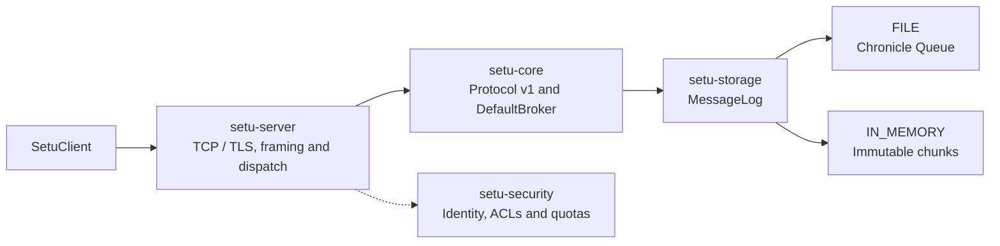

# Setu

Setu is a **single-node message broker in Java 26** with topics, partitions, ordered offsets and a binary TCP protocol. **OpenHFT Chronicle Queue is the default durable storage engine**; an explicit in-memory mode supports volatile workloads.

[Build and CI](https://github.com/RishabhRathi-Dev/Setu/actions/workflows/ci.yml) · [Server guide](setu-server/README.md) · [Client API](setu-client/README.md) · [Benchmarks](setu-benchmark/README.md)

## Quick start

Install a Java 26 JDK, set `JAVA_HOME`, and put its `bin` directory on `PATH`. The checked-in Maven Wrapper downloads Maven on first use.

From the repository root on Windows:

```powershell
.\mvnw.cmd -pl setu-server -am package
.\scripts\start-broker.ps1 --config config/server.properties
```

On Linux or macOS:

```bash
bash ./mvnw -pl setu-server -am package
bash ./scripts/start-broker.sh --config config/server.properties
```

The broker listens on **127.0.0.1:9092**, stores messages under `data/`, and writes rolling operational logs under `logs/`. Ctrl+C closes the broker. The standalone launcher serves plaintext; use [secure embedding](setu-server/README.md#secure-broker-wiring-example) for TLS/mTLS listeners.

Both launchers load [config/jvm.options](config/jvm.options), including ZGC, string deduplication and Chronicle's required module/native access. Optional AOT training is available through `--train-aot`; regenerate the cache after changing the application, dependencies or JDK. See the [launch and AOT instructions](setu-server/README.md#standalone-jar).

Configure the broker in [config/server.properties](config/server.properties):

| Setting | Default | Purpose |
| --- | --- | --- |
| `storage.mode` | `FILE` | Chronicle Queue; use `IN_MEMORY` for volatile storage |
| `data.dir` | `data` | Topic and partition data root |
| `transport` | `blocking` | Virtual thread per connection; `selector` supports plaintext multiplexing |
| `record.max.bytes` | 1 MiB | Maximum record payload |
| `queue.block.bytes` | 64 MiB | Chronicle mapping block size, with a 64 MiB minimum |
| `memory.log.max.bytes` | 256 MiB | Shared retained-log budget in memory mode |
| `ack.timeout.millis` | 30,000 | Deadline for acknowledging fetched records |
| `consumer.timeout.millis` | 60,000 | Consumer inactivity deadline |

Use [SetuClient](setu-client/README.md#example) to create topics, produce records and fetch by offset. It supports single-record and batched writes, long polling, membership, heartbeats and acknowledgements. Broker errors are returned as structured responses; callers must check `errorCode()`.

## Current implementation snapshot

- **Messaging:** topic creation and metadata, partitioned append/fetch, single and batch produce, group membership and offset acknowledgements.
- **Protocol:** version 1 binary frames, correlation IDs, strict validation, bounded request/response admission and structured errors.
- **Concurrency:** immutable payload ownership, CAS-based memory publication and write admission, bounded group commit, and coordinated consumer bookkeeping.
- **Security:** embedded TLS/mTLS listeners, DNS SAN client identity, default-deny exact ACL grants, and per-principal message/byte quotas.
- **Verification:** unit tests, real TCP/mTLS integration tests, process-kill recovery, bounded chaos, JFR profiles and AOT cache validation.

The broker runs in one process. Consumer membership, committed offsets, ACL grants and quota policies are process-local. Replication, failover, automatic consumer-group assignment/rebalancing, file retention and payload checksums are not implemented. The client is synchronous and has no automatic retry, reconnect or idempotent produce.

## Architecture



The server owns transport and request policy, core owns broker operations and shared protocol types, and storage owns the mapping from logical offsets to physical records. PostgreSQL is not part of the runtime.

| Module | Responsibility |
| --- | --- |
| [setu-core](setu-core/README.md) | Broker API, topics/partitions, consumer bookkeeping and shared wire codec |
| [setu-storage](setu-storage/README.md) | Chronicle Queue, in-memory logs, admission, group commit and recovery |
| [setu-server](setu-server/README.md) | Standalone launcher, TCP transports, secure dispatch and AOT training |
| [setu-client](setu-client/README.md) | Synchronous plaintext and TLS client |
| [setu-security](setu-security/README.md) | Certificate identity, authorization and token-bucket quotas |
| [setu-integration-tests](setu-integration-tests/README.md) | Functional requirements over real TCP and mTLS |
| [setu-benchmark](setu-benchmark/README.md) | Load measurement, JFR, crash recovery and chaos workloads |

## Storage and backpressure

### Durable mode: `FILE`

Each partition uses Chronicle Queue 2026.6 with native daily rolled `.cq4` files under `<data.dir>/<topic>/partition-<id>/`. Setu exposes dense, zero-based record offsets independently of Chronicle's physical indexes. The mapping block size does not limit daily file size or enable retention.

A bounded writer groups adjacent produce requests. Success is returned after JDK mapped-file and channel forces cover touched queue files, indexes and roll metadata. The adapter uses this explicit force path because the resolved OpenHFT native Windows sync is a no-op. A partition has one broker owner. Durable writes serialize, while reads of previously committed records can proceed during forcing.

Restart validates committed documents and rebuilds Setu's sparse logical-offset index. Malformed committed data fails startup. Failed or lost acknowledgements can have an uncertain outcome; this is local persistence without replication or exactly-once delivery.

Existing length-prefixed `.log` data requires [offline migration into a fresh data root](setu-storage/README.md#migrating-existing-data). The importer preserves the source files.

### Volatile mode: `IN_MEMORY`

Complete batches publish as immutable chunks with CAS. Group members start at their join-time offsets; acknowledgements and member removal allow reclamation through the slowest registered member. Logical offsets remain monotonic as prefixes are removed. Restart discards topics and messages. Optional time-based expiry is lossy and disabled by default.

The memory budget reserves whole batches before publication. Memory-log and durable write-queue saturation return `QUOTA_EXCEEDED`; clients can retry with backoff after consumer progress. Transport buffers have separate admission limits and can close a connection when no error reply can be admitted. These limits account for specific allocations, rather than imposing a total process-memory cap. See [storage semantics](setu-storage/README.md) and [server limits](setu-server/README.md).

## Security

`SecureServerFactory` composes mTLS authentication, request authorization and quotas with the broker. Client identities come from DNS subject alternative names; ACLs match exact principal/resource/permission grants and deny by default. TLS clients verify the broker hostname. The standalone properties launcher does not configure this secure path.

See the [security module](setu-security/README.md) and [server integration guide](setu-server/README.md) for embedding. Development certificate scripts are available under `scripts/generate-certs.ps1` and `scripts/generate-certs.sh`.

## Tests

Run production-module tests and functional TCP/mTLS integration tests without starting the capacity-exhaustion workload:

```powershell
.\mvnw.cmd -pl setu-integration-tests -am test
```

Use `bash ./mvnw` in place of `.\mvnw.cmd` on Linux/macOS. Python 3 is needed for benchmark tooling and its report tests:

```bash
python -m unittest discover -s scripts -p 'test_benchmark*.py'
```

[CI](.github/workflows/ci.yml) also runs bounded chaos, isolated load checks, sustained smoke, node-target measurements with JFR, and secure AOT cache validation. Detailed benchmark commands and qualification rules live in the [benchmark guide](setu-benchmark/README.md).

## Performance

The reference targets are **500K records/s in memory** and **250K records/s durable**, using 1 KiB records. Qualification requires sustained unique consumption, measured latency, stable heap, bounded CPU and zero request errors. Targets are goals, not guarantees.

The local Chronicle Windows diagnostic measured approximately **55K durable records/s** with real mapped-file forcing and did not qualify. Earlier custom-backend results do not establish Chronicle performance. See the [measurements and methods](setu-benchmark/README.md#default-openhft-storage).

The generated badges and diagnostics retain their measured source revision and qualification status. Read results against that revision: measurements from the former custom backend do not qualify the Chronicle engine. CI refreshes these blocks from subsequent measurements.

<!-- benchmark-metrics-badges:start -->
[](https://github.com/RishabhRathi-Dev/Setu/actions/runs/39317780845)
[](https://github.com/RishabhRathi-Dev/Setu/actions/runs/39317780845)
<!-- benchmark-metrics-badges:end -->

<details>
<summary>Latest recorded target diagnostics and qualification details</summary>

<!-- benchmark-target-diagnostics:start -->
[](https://github.com/RishabhRathi-Dev/Setu/actions/runs/39317780845)
[](https://github.com/RishabhRathi-Dev/Setu/actions/runs/39317780845)
[](https://github.com/RishabhRathi-Dev/Setu/actions/runs/39317780845)
[](https://github.com/RishabhRathi-Dev/Setu/actions/runs/39317780845)
[](https://github.com/RishabhRathi-Dev/Setu/actions/runs/39317780845)
[](https://github.com/RishabhRathi-Dev/Setu/actions/runs/39317780845)
<!-- benchmark-target-diagnostics:end -->

<!-- benchmark-capacity-details:start -->
Latest source: **CI**, revision `c88bb3b4ceaa4d2dbb8a6a7f20818f9baca652b0`. [Benchmark run/report](https://github.com/RishabhRathi-Dev/Setu/actions/runs/39317780845).

Runner: AMD EPYC 7763 64-Core Processor; 1.6 enforced CPU cores; 128 MiB worker heap; filesystem/media /dev/sda1 ext4 (rotational).

Runner: AMD EPYC 7763 64-Core Processor; 1.6 enforced CPU cores; 256 MiB worker heap; filesystem/media /dev/sda1 ext4 (rotational).

# Node-target measurements

Three independent repetitions; 1 KiB records; 10s or longer warmup and 30s measurement at 50%, 80% and 100% of target. File acknowledgments follow force of every touched segment. Health requires 95% consumption and offered throughput, zero errors, HDR p99 within mode/load limits, CPU <=85% of the allocated budget, heap <=1 GiB and heap slope <=1 MiB/s. CPU qualification is evaluated before display rounding; CPU percentages show four decimal places.

| Mode | Target/s | Median measured/s | Worst target p99 ms | Peak heap MiB | Peak average CPU % | Qualified |
| --- | ---: | ---: | ---: | ---: | ---: | --- |
| IN_MEMORY | 500,000 | 322,782 | 10737.418 | 256 | 99.5810 | False |
| FILE | 250,000 | 126,345 | 14705.230 | 124 | 97.8750 | False |

| Mode | Repeat | Load | Measured/s | Consumed/s | p99 ms | CPU % | Heap slope MiB/s | Healthy |
| --- | ---: | ---: | ---: | ---: | ---: | ---: | ---: | --- |
| FILE | 1 | 50% | 124,996 | 125,013 | 93.848 | 95.5148 | 0.236 | False |
| FILE | 1 | 80% | 124,902 | 124,911 | 11156.849 | 88.9938 | 0.054 | False |
| FILE | 1 | 100% | 126,293 | 126,293 | 14688.453 | 88.7450 | 0.127 | False |
| FILE | 2 | 50% | 124,988 | 124,996 | 284.164 | 97.8750 | 0.187 | False |
| FILE | 2 | 80% | 126,379 | 126,396 | 10930.356 | 89.4164 | 0.092 | False |
| FILE | 2 | 100% | 126,421 | 126,438 | 14696.841 | 87.7498 | 0.019 | False |
| FILE | 3 | 50% | 124,996 | 125,022 | 65.929 | 97.1220 | 0.244 | False |
| FILE | 3 | 80% | 126,370 | 126,387 | 10947.133 | 89.4551 | -0.001 | False |
| FILE | 3 | 100% | 126,345 | 126,336 | 14705.230 | 89.3529 | -0.044 | False |
| IN_MEMORY | 1 | 50% | 249,993 | 251,017 | 140.509 | 88.1433 | 0.004 | False |
| IN_MEMORY | 1 | 80% | 275,951 | 275,951 | 9261.023 | 99.4574 | -0.133 | False |
| IN_MEMORY | 1 | 100% | 322,782 | 322,773 | 10519.314 | 99.5584 | 0.206 | False |
| IN_MEMORY | 2 | 50% | 249,993 | 251,025 | 223.871 | 89.0396 | -0.489 | False |
| IN_MEMORY | 2 | 80% | 278,605 | 278,613 | 9000.976 | 99.4134 | -0.132 | False |
| IN_MEMORY | 2 | 100% | 320,034 | 320,043 | 10737.418 | 99.4998 | 0.122 | False |
| IN_MEMORY | 3 | 50% | 249,993 | 251,034 | 151.781 | 88.4557 | -0.304 | False |
| IN_MEMORY | 3 | 80% | 319,932 | 320,017 | 5968.495 | 99.5624 | 0.132 | False |
| IN_MEMORY | 3 | 100% | 327,492 | 327,270 | 10259.268 | 99.5810 | 0.146 | False |

Qualification failures (completed measurements are retained):

| Mode | Repeat | Load | Measured limit failures |
| --- | ---: | ---: | --- |
| FILE | 1 | 50% | p99 93.848 ms outside [0,10) ms; CPU 95.5148% outside 0–85% of allocated budget |
| FILE | 1 | 80% | throughput 124,902/s <95% of offered 200,000/s; p99 11156.849 ms outside [0,100) ms; CPU 88.9938% outside 0–85% of allocated budget |
| FILE | 1 | 100% | throughput 126,293/s <95% of offered 250,000/s; p99 14688.453 ms outside [0,100) ms; CPU 88.7450% outside 0–85% of allocated budget |
| FILE | 2 | 50% | p99 284.164 ms outside [0,10) ms; CPU 97.8750% outside 0–85% of allocated budget |
| FILE | 2 | 80% | throughput 126,379/s <95% of offered 200,000/s; p99 10930.356 ms outside [0,100) ms; CPU 89.4164% outside 0–85% of allocated budget |
| FILE | 2 | 100% | throughput 126,421/s <95% of offered 250,000/s; p99 14696.841 ms outside [0,100) ms; CPU 87.7498% outside 0–85% of allocated budget |
| FILE | 3 | 50% | p99 65.929 ms outside [0,10) ms; CPU 97.1220% outside 0–85% of allocated budget |
| FILE | 3 | 80% | throughput 126,370/s <95% of offered 200,000/s; p99 10947.133 ms outside [0,100) ms; CPU 89.4551% outside 0–85% of allocated budget |
| FILE | 3 | 100% | throughput 126,345/s <95% of offered 250,000/s; p99 14705.230 ms outside [0,100) ms; CPU 89.3529% outside 0–85% of allocated budget |
| IN_MEMORY | 1 | 50% | p99 140.509 ms outside [0,5) ms; CPU 88.1433% outside 0–85% of allocated budget |
| IN_MEMORY | 1 | 80% | throughput 275,951/s <95% of offered 400,000/s; p99 9261.023 ms outside [0,50) ms; CPU 99.4574% outside 0–85% of allocated budget |
| IN_MEMORY | 1 | 100% | throughput 322,782/s <95% of offered 500,000/s; p99 10519.314 ms outside [0,50) ms; CPU 99.5584% outside 0–85% of allocated budget |
| IN_MEMORY | 2 | 50% | p99 223.871 ms outside [0,5) ms; CPU 89.0396% outside 0–85% of allocated budget |
| IN_MEMORY | 2 | 80% | throughput 278,605/s <95% of offered 400,000/s; p99 9000.976 ms outside [0,50) ms; CPU 99.4134% outside 0–85% of allocated budget |
| IN_MEMORY | 2 | 100% | throughput 320,034/s <95% of offered 500,000/s; p99 10737.418 ms outside [0,50) ms; CPU 99.4998% outside 0–85% of allocated budget |
| IN_MEMORY | 3 | 50% | p99 151.781 ms outside [0,5) ms; CPU 88.4557% outside 0–85% of allocated budget |
| IN_MEMORY | 3 | 80% | throughput 319,932/s <95% of offered 400,000/s; p99 5968.495 ms outside [0,50) ms; CPU 99.5624% outside 0–85% of allocated budget |
| IN_MEMORY | 3 | 100% | throughput 327,492/s <95% of offered 500,000/s; p99 10259.268 ms outside [0,50) ms; CPU 99.5810% outside 0–85% of allocated budget |

Latency components (scheduled completion includes offered-load scheduling delay):

| Mode | Repeat | Load | Produce p99 ms | Fetch p99 ms | Ack p99 ms | Scheduled p99 ms |
| --- | ---: | ---: | ---: | ---: | ---: | ---: |
| FILE | 1 | 50% | 9.118 | 2.154 | 2.288 | 93.848 |
| FILE | 1 | 80% | 33.423 | 2.277 | 2.214 | 11156.849 |
| FILE | 1 | 100% | 33.456 | 2.173 | 1.823 | 14688.453 |
| FILE | 2 | 50% | 12.575 | 2.037 | 2.236 | 284.164 |
| FILE | 2 | 80% | 33.784 | 2.443 | 2.154 | 10930.356 |
| FILE | 2 | 100% | 33.849 | 2.310 | 1.940 | 14696.841 |
| FILE | 3 | 50% | 8.536 | 1.849 | 1.860 | 65.929 |
| FILE | 3 | 80% | 33.096 | 2.472 | 2.187 | 10947.133 |
| FILE | 3 | 100% | 34.505 | 1.992 | 1.716 | 14705.230 |
| IN_MEMORY | 1 | 50% | 1.613 | 0.690 | 0.582 | 140.509 |
| IN_MEMORY | 1 | 80% | 5.698 | 2.757 | 2.101 | 9261.023 |
| IN_MEMORY | 1 | 100% | 5.054 | 2.951 | 2.089 | 10519.314 |
| IN_MEMORY | 2 | 50% | 2.298 | 0.818 | 0.793 | 223.871 |
| IN_MEMORY | 2 | 80% | 5.284 | 2.623 | 2.010 | 9000.976 |
| IN_MEMORY | 2 | 100% | 5.255 | 2.951 | 2.052 | 10737.418 |
| IN_MEMORY | 3 | 50% | 2.177 | 0.828 | 0.752 | 151.781 |
| IN_MEMORY | 3 | 80% | 5.337 | 3.060 | 2.097 | 5968.495 |
| IN_MEMORY | 3 | 100% | 5.218 | 2.836 | 1.985 | 10259.268 |

File-force waits from measured JFR stages:

| Mode | Repeat | Stage | Calls | Total wait ms | p99 wait ms | Max wait ms |
| --- | ---: | ---: | ---: | ---: | ---: | ---: |
| FILE | 1 | 1 | 14667 | 19937.422965 | 5.484543 | 29.467025 |
| FILE | 1 | 2 | 14641 | 40198.511135 | 32.243711 | 40.075328 |
| FILE | 1 | 3 | 14804 | 39702.930577 | 32.112639 | 41.551767 |
| FILE | 2 | 1 | 14657 | 18247.784412 | 5.992447 | 30.593247 |
| FILE | 2 | 2 | 14813 | 37839.087994 | 31.031295 | 63.244333 |
| FILE | 2 | 3 | 14818 | 38223.172015 | 31.768575 | 42.009234 |
| FILE | 3 | 1 | 14665 | 17087.971499 | 4.947967 | 24.617276 |
| FILE | 3 | 2 | 14813 | 37057.168970 | 29.278207 | 40.490611 |
| FILE | 3 | 3 | 14809 | 40117.015139 | 32.899071 | 41.925791 |
| IN_MEMORY | 1 | 1 | 0 | 0.000000 | 0.000000 | 0.000000 |
| IN_MEMORY | 1 | 2 | 0 | 0.000000 | 0.000000 | 0.000000 |
| IN_MEMORY | 1 | 3 | 0 | 0.000000 | 0.000000 | 0.000000 |
| IN_MEMORY | 2 | 1 | 0 | 0.000000 | 0.000000 | 0.000000 |
| IN_MEMORY | 2 | 2 | 0 | 0.000000 | 0.000000 | 0.000000 |
| IN_MEMORY | 2 | 3 | 0 | 0.000000 | 0.000000 | 0.000000 |
| IN_MEMORY | 3 | 1 | 0 | 0.000000 | 0.000000 | 0.000000 |
| IN_MEMORY | 3 | 2 | 0 | 0.000000 | 0.000000 | 0.000000 |
| IN_MEMORY | 3 | 3 | 0 | 0.000000 | 0.000000 | 0.000000 |

Waits are elapsed time inside jdk.FileForce, clipped to each measured stage. Concurrent calls are summed separately, so total wait can exceed stage duration. New recordings capture every force; older recordings may omit fast calls. Unavailable metrics indicate an older summary, rather than zero waits.
<!-- benchmark-capacity-details:end -->

</details>

### FILE baseline latency

Recorded **2026-10-17**. The strict FILE baseline offers **80,000 records/s**, separately from the 250K durable reference target above. It uses 1 KiB records, 256-record batches, 1.6 enforced CPU cores, a 5 GiB memory limit and a 128 MiB worker heap. Three independent repetitions each measure 50%, 80% and 100% load after at least 10s warmup, with 30s per measured window. Qualification requires scheduled-completion p99 **<10 ms at 50% load** and **<100 ms at higher loads**, plus the existing throughput, consumption, resource and error gates. Scheduled latency includes pacing backlog and recovery after a stall.

| Run / configuration | Qualified windows | Worst 50%-load p99 ms | Worst 100%-load p99 ms | Median 100%-load records/s |
| --- | ---: | ---: | ---: | ---: |
| [Original implementation, `123a1d5`](https://github.com/RishabhRathi-Dev/Setu/actions/runs/38947239551) | 8/9 | 404.226 | 6.054 | 79,991 |
| [Same-size data-only force candidate, `b8f6a6a`](https://github.com/RishabhRathi-Dev/Setu/actions/runs/39009943580) | 0/9 | 2,405.433 | 15,493.759 | 47,403 |
| [Experimental private journal, `71d0a1a`](https://github.com/RishabhRathi-Dev/Setu/actions/runs/39011113017) | 2/9 | 717.750 | 6,585.057 | 68,762 |
| [Default configuration with kernel tracing, `6d83c21`](https://github.com/RishabhRathi-Dev/Setu/actions/runs/39012198818) | 9/9 | 7.406 | 7.868 | 79,991 |

These are separate hosted runs, not a controlled before/after comparison: hosts and storage differed. The passing trace used EPYC 7763 with `/dev/sda1` ext4; recent failed runs used EPYC 9V74 with `/dev/nvme0n1p1` ext4. Its observer also consumed 61.640 CPU seconds over 391.979s, so it is a passing control, not proof of a general fix. Trace mode intentionally skipped non-FILE jobs. The private-journal experiment was removed; the normal baseline retains the default runner, temp directory, workload and qualification gates.

The original failed window had request p99 **9.527 ms** but scheduled p99 **404.226 ms**, with coincident file-force calls around **383 ms**. Its longest recorded GC pause was **0.137 ms**. [Original comparison and JFR](https://github.com/RishabhRathi-Dev/Setu/actions/runs/38947239551/artifacts/12067726785), [candidate evidence](https://github.com/RishabhRathi-Dev/Setu/actions/runs/39009943580/artifacts/12092448405), [private-journal evidence](https://github.com/RishabhRathi-Dev/Setu/actions/runs/39011113017/artifacts/12092834175) and [passing trace](https://github.com/RishabhRathi-Dev/Setu/actions/runs/39012198818/artifacts/12093770791) retain the measured windows and captures; CI artifacts have 14-day retention.

A separate [storage-only reproduction](https://github.com/RishabhRathi-Dev/Setu/actions/runs/39012781206), with two real mapped writers and the same resource limits, recorded these native force latencies without broker work:

| Barrier | Force p99 ms | Maximum force ms |
| --- | ---: | ---: |
| Full metadata force | 181.707 | 361.423 |
| Same-size data-only force | 10.363 | 252.253 |

During a captured 252.244 ms data-only force, both writers waited inside ext4 data writeback; CPU-throttle counters did not increase and memory-limit event counters stayed zero. Other captured waits included journal commits and block writeback throttling. The observer consumed 1.083 CPU seconds over 21.609s. [JFR and kernel stacks](https://github.com/RishabhRathi-Dev/Setu/actions/runs/39012781206/artifacts/12093636320) establish storage-path blocking in this reproduction, but do not establish the exact cause of the original untraced event. These short sequential probes include warmup/order effects and do not qualify sustained throughput; only the diagnostic job ran.

The retained Linux optimization uses full metadata forcing initially and after file-size changes, then data-only forcing for same-size writes. All touched payload, index/header and metadata files still complete their barriers before acknowledgment. Existing tests and thresholds are unchanged; unit, integration, benchmark-helper and AOT checks passed. Local Linux before/after baselines both qualified 9/9 windows: worst half-load p99 **7.492 → 6.701 ms**, worst full-load p99 **7.479 → 6.820 ms**, and median full-load throughput **79,991/s** in both.

**Intermittent hosted latency remains unresolved.** Local measurements improved, but the optimization has not demonstrated consistent qualification across environments. Durable acknowledgments must wait for storage barriers, so a universal 10 ms latency bound cannot hold on storage that stalls for hundreds of milliseconds.
