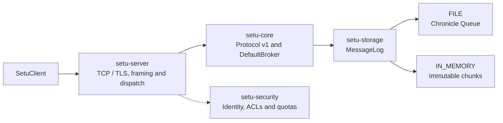

# Setu

Setu is a **single-node message broker in Java 26** with topics, partitions, ordered offsets and a binary TCP protocol. **OpenHFT Chronicle Queue is the default durable storage engine**; an explicit in-memory mode supports volatile workloads.

[Build and CI](https://github.com/RishabhRathi-Dev/Setu/actions/workflows/ci.yml) · [Server guide](setu-server/README.md) · [Client API](setu-client/README.md) · [Benchmarks](setu-benchmark/README.md)

## Quick start

Install a Java 26 JDK, set `JAVA_HOME`, and put its `bin` directory on `PATH`. The checked-in Maven Wrapper downloads Maven on first use.

From the repository root on Windows:

```powershell
.\mvnw.cmd -pl setu-server -am package
.\scripts\start-broker.ps1 --config config/server.properties
```

On Linux or macOS:

```bash
bash ./mvnw -pl setu-server -am package
bash ./scripts/start-broker.sh --config config/server.properties
```

The broker listens on **127.0.0.1:9092**, stores messages under `data/`, and writes rolling operational logs under `logs/`. Ctrl+C closes the broker. The standalone launcher serves plaintext; use [secure embedding](setu-server/README.md#secure-broker-wiring-example) for TLS/mTLS listeners.

Both launchers load [config/jvm.options](config/jvm.options), including ZGC, string deduplication and Chronicle's required module/native access. Optional AOT training is available through `--train-aot`; regenerate the cache after changing the application, dependencies or JDK. See the [launch and AOT instructions](setu-server/README.md#standalone-jar).

Configure the broker in [config/server.properties](config/server.properties):

| Setting | Default | Purpose |
| --- | --- | --- |
| `storage.mode` | `FILE` | Chronicle Queue; use `IN_MEMORY` for volatile storage |
| `data.dir` | `data` | Topic and partition data root |
| `transport` | `blocking` | Virtual thread per connection; `selector` supports plaintext multiplexing |
| `record.max.bytes` | 1 MiB | Maximum record payload |
| `queue.block.bytes` | 64 MiB | Chronicle mapping block size, with a 64 MiB minimum |
| `memory.log.max.bytes` | 256 MiB | Shared retained-log budget in memory mode |
| `ack.timeout.millis` | 30,000 | Deadline for acknowledging fetched records |
| `consumer.timeout.millis` | 60,000 | Consumer inactivity deadline |

Use [SetuClient](setu-client/README.md#example) to create topics, produce records and fetch by offset. It supports single-record and batched writes, long polling, membership, heartbeats and acknowledgements. Broker errors are returned as structured responses; callers must check `errorCode()`.

## Current implementation snapshot

- **Messaging:** topic creation and metadata, partitioned append/fetch, single and batch produce, group membership and offset acknowledgements.
- **Protocol:** version 1 binary frames, correlation IDs, strict validation, bounded request/response admission and structured errors.
- **Concurrency:** immutable payload ownership, CAS-based memory publication and write admission, bounded group commit, and coordinated consumer bookkeeping.
- **Security:** embedded TLS/mTLS listeners, DNS SAN client identity, default-deny exact ACL grants, and per-principal message/byte quotas.
- **Verification:** unit tests, real TCP/mTLS integration tests, process-kill recovery, bounded chaos, JFR profiles and AOT cache validation.

The broker runs in one process. Consumer membership, committed offsets, ACL grants and quota policies are process-local. Replication, failover, automatic consumer-group assignment/rebalancing, file retention and payload checksums are not implemented. The client is synchronous and has no automatic retry, reconnect or idempotent produce.

## Architecture



The server owns transport and request policy, core owns broker operations and shared protocol types, and storage owns the mapping from logical offsets to physical records. PostgreSQL is not part of the runtime.

| Module | Responsibility |
| --- | --- |
| [setu-core](setu-core/README.md) | Broker API, topics/partitions, consumer bookkeeping and shared wire codec |
| [setu-storage](setu-storage/README.md) | Chronicle Queue, in-memory logs, admission, group commit and recovery |
| [setu-server](setu-server/README.md) | Standalone launcher, TCP transports, secure dispatch and AOT training |
| [setu-client](setu-client/README.md) | Synchronous plaintext and TLS client |
| [setu-security](setu-security/README.md) | Certificate identity, authorization and token-bucket quotas |
| [setu-integration-tests](setu-integration-tests/README.md) | Functional requirements over real TCP and mTLS |
| [setu-benchmark](setu-benchmark/README.md) | Load measurement, JFR, crash recovery and chaos workloads |

## Storage and backpressure

### Durable mode: `FILE`

Each partition uses Chronicle Queue 2026.6 with native daily rolled `.cq4` files under `<data.dir>/<topic>/partition-<id>/`. Setu exposes dense, zero-based record offsets independently of Chronicle's physical indexes. The mapping block size does not limit daily file size or enable retention.

A bounded writer groups adjacent produce requests. Success is returned after JDK mapped-file and channel forces cover touched queue files, indexes and roll metadata. The adapter uses this explicit force path because the resolved OpenHFT native Windows sync is a no-op. A partition has one broker owner. Durable writes serialize, while reads of previously committed records can proceed during forcing.

Restart validates committed documents and rebuilds Setu's sparse logical-offset index. Malformed committed data fails startup. Failed or lost acknowledgements can have an uncertain outcome; this is local persistence without replication or exactly-once delivery.

Existing length-prefixed `.log` data requires [offline migration into a fresh data root](setu-storage/README.md#migrating-existing-data). The importer preserves the source files.

### Volatile mode: `IN_MEMORY`

Complete batches publish as immutable chunks with CAS. Group members start at their join-time offsets; acknowledgements and member removal allow reclamation through the slowest registered member. Logical offsets remain monotonic as prefixes are removed. Restart discards topics and messages. Optional time-based expiry is lossy and disabled by default.

The memory budget reserves whole batches before publication. Memory-log and durable write-queue saturation return `QUOTA_EXCEEDED`; clients can retry with backoff after consumer progress. Transport buffers have separate admission limits and can close a connection when no error reply can be admitted. These limits account for specific allocations, rather than imposing a total process-memory cap. See [storage semantics](setu-storage/README.md) and [server limits](setu-server/README.md).

## Security

`SecureServerFactory` composes mTLS authentication, request authorization and quotas with the broker. Client identities come from DNS subject alternative names; ACLs match exact principal/resource/permission grants and deny by default. TLS clients verify the broker hostname. The standalone properties launcher does not configure this secure path.

See the [security module](setu-security/README.md) and [server integration guide](setu-server/README.md) for embedding. Development certificate scripts are available under `scripts/generate-certs.ps1` and `scripts/generate-certs.sh`.

## Tests

Run production-module tests and functional TCP/mTLS integration tests without starting the capacity-exhaustion workload:

```powershell
.\mvnw.cmd -pl setu-integration-tests -am test
```

Use `bash ./mvnw` in place of `.\mvnw.cmd` on Linux/macOS. Python 3 is needed for benchmark tooling and its report tests:

```bash
python -m unittest discover -s scripts -p 'test_benchmark*.py'
```

[CI](.github/workflows/ci.yml) also runs bounded chaos, isolated load checks, sustained smoke, node-target measurements with JFR, and secure AOT cache validation. Detailed benchmark commands and qualification rules live in the [benchmark guide](setu-benchmark/README.md).

## Performance

The reference targets are **500K records/s in memory** and **250K records/s durable**, using 1 KiB records. Qualification requires sustained unique consumption, measured latency, stable heap, bounded CPU and zero request errors. Targets are goals, not guarantees.

The local Chronicle Windows diagnostic measured approximately **55K durable records/s** with real mapped-file forcing and did not qualify. Earlier custom-backend results do not establish Chronicle performance. See the [measurements and methods](setu-benchmark/README.md#default-openhft-storage).

The generated badges and diagnostics retain their measured source revision and qualification status. Read results against that revision: measurements from the former custom backend do not qualify the Chronicle engine. CI refreshes these blocks from subsequent measurements.

<!-- benchmark-metrics-badges:start -->
[](https://github.com/RishabhRathi-Dev/Setu/actions/runs/38942016499)
[](https://github.com/RishabhRathi-Dev/Setu/actions/runs/38942016499)
<!-- benchmark-metrics-badges:end -->

<details>
<summary>Latest recorded target diagnostics and qualification details</summary>

<!-- benchmark-target-diagnostics:start -->
[](https://github.com/RishabhRathi-Dev/Setu/actions/runs/38942016499)
[](https://github.com/RishabhRathi-Dev/Setu/actions/runs/38942016499)
[](https://github.com/RishabhRathi-Dev/Setu/actions/runs/38942016499)
[](https://github.com/RishabhRathi-Dev/Setu/actions/runs/38942016499)
[](https://github.com/RishabhRathi-Dev/Setu/actions/runs/38942016499)
[](https://github.com/RishabhRathi-Dev/Setu/actions/runs/38942016499)
<!-- benchmark-target-diagnostics:end -->

<!-- benchmark-capacity-details:start -->
Latest source: **CI**, revision `fdb2e11d81a80d28756cbff9d0aba9bf38c41705`. [Benchmark run/report](https://github.com/RishabhRathi-Dev/Setu/actions/runs/38942016499).

Runner: Intel(R) Xeon(R) Platinum 8370C CPU @ 2.80GHz; 1.6 enforced CPU cores; 128 MiB worker heap; filesystem/media /dev/sda1 ext4 (rotational).

Runner: AMD EPYC 9V74 80-Core Processor; 1.6 enforced CPU cores; 256 MiB worker heap; filesystem/media /dev/nvme0n1p1 ext4 (non-rotational).

# Node-target measurements

Three independent repetitions; 1 KiB records; 10s or longer warmup and 30s measurement at 50%, 80% and 100% of target. File acknowledgments follow force of every touched segment. Health requires 95% consumption and offered throughput, zero errors, HDR p99 within mode/load limits, CPU <=85% of the allocated budget, heap <=1 GiB and heap slope <=1 MiB/s. CPU qualification is evaluated before display rounding; CPU percentages show four decimal places.

| Mode | Target/s | Median measured/s | Worst target p99 ms | Peak heap MiB | Peak average CPU % | Qualified |
| --- | ---: | ---: | ---: | ---: | ---: | --- |
| IN_MEMORY | 500,000 | 362,240 | 8648.655 | 256 | 99.5372 | False |
| FILE | 250,000 | 126,208 | 14772.339 | 126 | 88.0392 | False |

| Mode | Repeat | Load | Measured/s | Consumed/s | p99 ms | CPU % | Heap slope MiB/s | Healthy |
| --- | ---: | ---: | ---: | ---: | ---: | ---: | ---: | --- |
| FILE | 1 | 50% | 124,314 | 124,322 | 235.536 | 80.5205 | 0.002 | False |
| FILE | 1 | 80% | 125,619 | 125,636 | 11383.341 | 77.0398 | 0.004 | False |
| FILE | 1 | 100% | 125,636 | 125,645 | 14772.339 | 76.1249 | 0.070 | False |
| FILE | 2 | 50% | 124,996 | 125,022 | 237.634 | 88.0392 | 0.394 | False |
| FILE | 2 | 80% | 126,430 | 126,447 | 11089.740 | 77.5593 | 0.121 | False |
| FILE | 2 | 100% | 126,208 | 126,217 | 14755.561 | 76.6233 | 0.047 | False |
| FILE | 3 | 50% | 124,996 | 125,013 | 70.255 | 83.7066 | 0.262 | False |
| FILE | 3 | 80% | 125,935 | 125,943 | 11022.631 | 75.4747 | -0.050 | False |
| FILE | 3 | 100% | 126,319 | 126,327 | 14688.453 | 75.4095 | -0.002 | False |
| IN_MEMORY | 1 | 50% | 249,993 | 250,044 | 0.989 | 69.1875 | 0.175 | True |
| IN_MEMORY | 1 | 80% | 400,000 | 400,009 | 1.535 | 81.9555 | 0.388 | True |
| IN_MEMORY | 1 | 100% | 499,994 | 500,002 | 1.781 | 93.8928 | 0.262 | False |
| IN_MEMORY | 2 | 50% | 249,993 | 250,078 | 0.929 | 69.0823 | 0.001 | True |
| IN_MEMORY | 2 | 80% | 354,995 | 355,004 | 3340.763 | 99.4341 | -0.246 | False |
| IN_MEMORY | 2 | 100% | 362,240 | 362,249 | 8187.281 | 99.5372 | -0.161 | False |
| IN_MEMORY | 3 | 50% | 249,993 | 250,001 | 1.152 | 66.7067 | 0.120 | True |
| IN_MEMORY | 3 | 80% | 351,138 | 351,147 | 3628.073 | 99.4986 | -0.098 | False |
| IN_MEMORY | 3 | 100% | 354,705 | 354,679 | 8648.655 | 99.4327 | -0.153 | False |

Qualification failures (completed measurements are retained):

| Mode | Repeat | Load | Measured limit failures |
| --- | ---: | ---: | --- |
| FILE | 1 | 50% | p99 235.536 ms outside [0,10) ms |
| FILE | 1 | 80% | throughput 125,619/s <95% of offered 200,000/s; p99 11383.341 ms outside [0,100) ms |
| FILE | 1 | 100% | throughput 125,636/s <95% of offered 250,000/s; p99 14772.339 ms outside [0,100) ms |
| FILE | 2 | 50% | p99 237.634 ms outside [0,10) ms; CPU 88.0392% outside 0–85% of allocated budget |
| FILE | 2 | 80% | throughput 126,430/s <95% of offered 200,000/s; p99 11089.740 ms outside [0,100) ms |
| FILE | 2 | 100% | throughput 126,208/s <95% of offered 250,000/s; p99 14755.561 ms outside [0,100) ms |
| FILE | 3 | 50% | p99 70.255 ms outside [0,10) ms |
| FILE | 3 | 80% | throughput 125,935/s <95% of offered 200,000/s; p99 11022.631 ms outside [0,100) ms |
| FILE | 3 | 100% | throughput 126,319/s <95% of offered 250,000/s; p99 14688.453 ms outside [0,100) ms |
| IN_MEMORY | 1 | 100% | CPU 93.8928% outside 0–85% of allocated budget |
| IN_MEMORY | 2 | 80% | throughput 354,995/s <95% of offered 400,000/s; p99 3340.763 ms outside [0,50) ms; CPU 99.4341% outside 0–85% of allocated budget |
| IN_MEMORY | 2 | 100% | throughput 362,240/s <95% of offered 500,000/s; p99 8187.281 ms outside [0,50) ms; CPU 99.5372% outside 0–85% of allocated budget |
| IN_MEMORY | 3 | 80% | throughput 351,138/s <95% of offered 400,000/s; p99 3628.073 ms outside [0,50) ms; CPU 99.4986% outside 0–85% of allocated budget |
| IN_MEMORY | 3 | 100% | throughput 354,705/s <95% of offered 500,000/s; p99 8648.655 ms outside [0,50) ms; CPU 99.4327% outside 0–85% of allocated budget |
<!-- benchmark-capacity-details:end -->

</details>

<details>
<summary>Historical capacity diagnostics</summary>

These older exhaustion/fanout measurements do not qualify sustained throughput.

<!-- benchmark-historical-badges:start -->
[](https://github.com/RishabhRathi-Dev/Setu/actions/workflows/ci.yml)
[](https://github.com/RishabhRathi-Dev/Setu/actions/workflows/ci.yml)
[](https://github.com/RishabhRathi-Dev/Setu/actions/workflows/ci.yml)
[](https://github.com/RishabhRathi-Dev/Setu/actions/workflows/ci.yml)
[](https://github.com/RishabhRathi-Dev/Setu/actions/workflows/ci.yml)
[](https://github.com/RishabhRathi-Dev/Setu/actions/workflows/ci.yml)
<!-- benchmark-historical-badges:end -->

</details>
