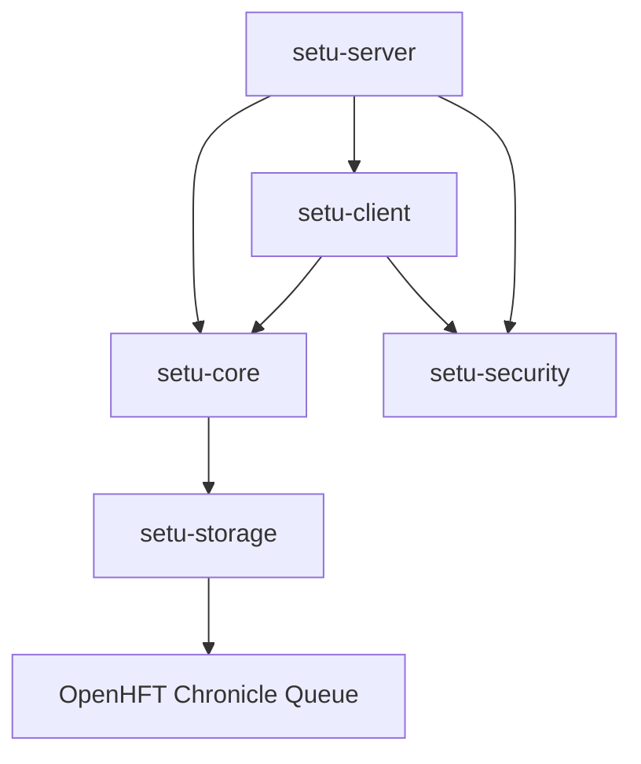
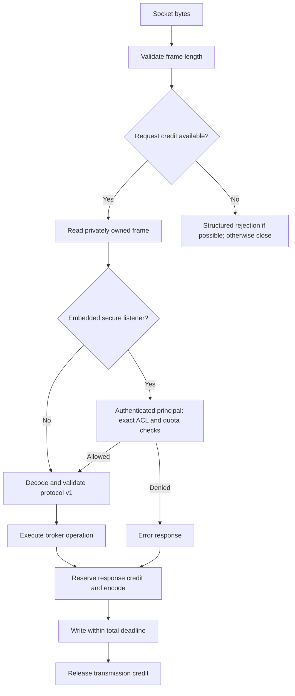
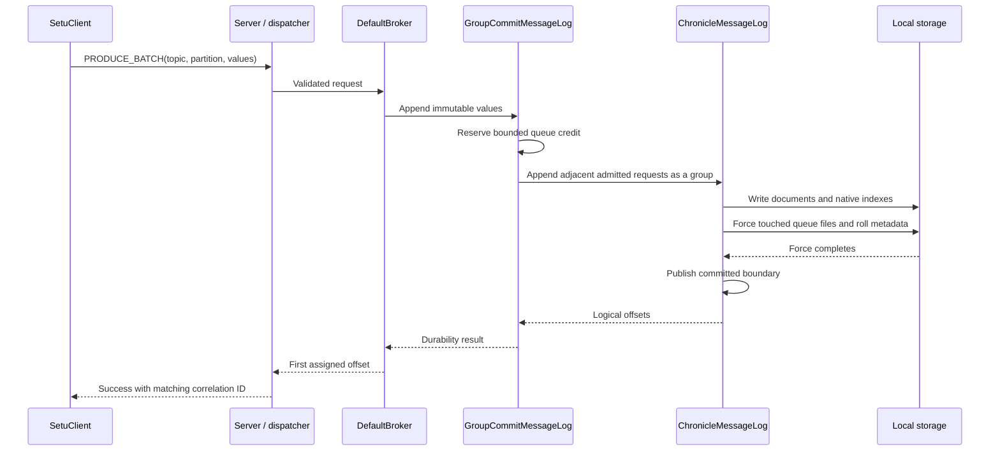
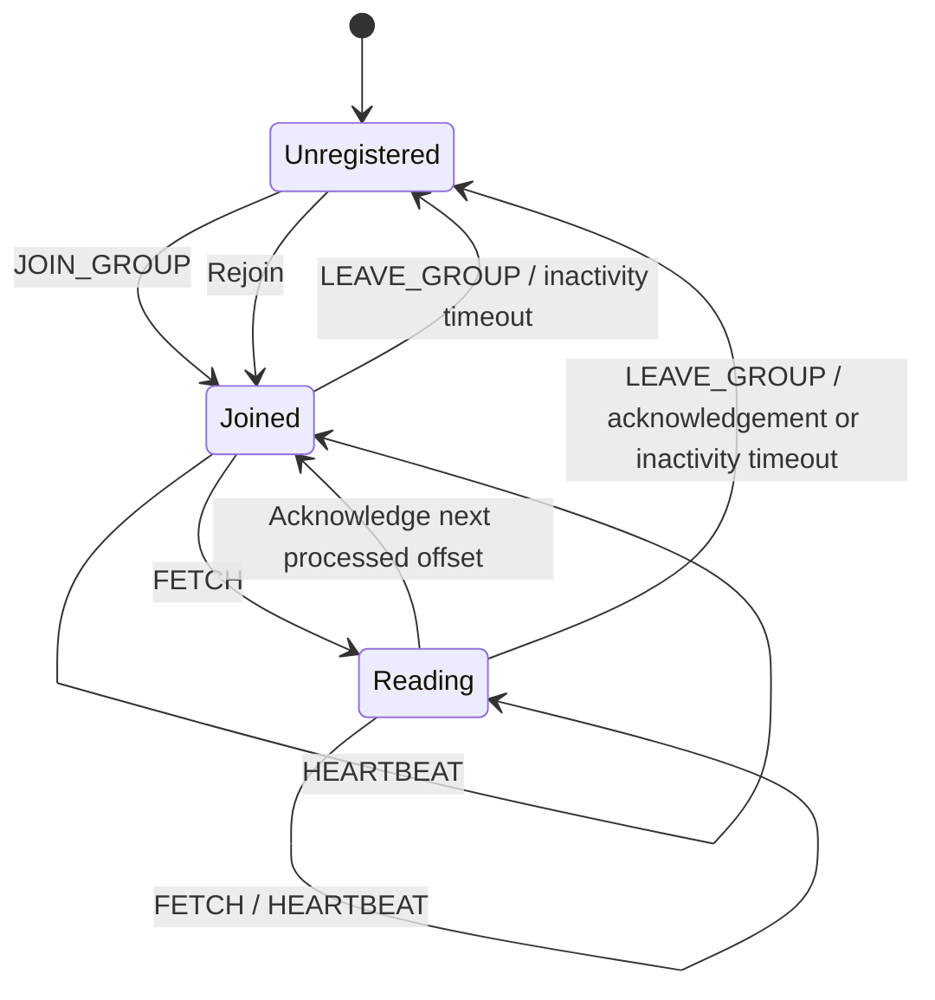

# Architecture

Setu is a single-process broker. A topic contains numbered partition logs; each partition assigns dense, monotonically increasing offsets to opaque byte-array records. Clients choose the topic, partition, and fetch offset. Ordering is per partition, with no global ordering across partitions.

This guide describes the implementation in the repository. [Core](../setu-core/README.md), [storage](../setu-storage/README.md), and [server](../setu-server/README.md) document the underlying contracts.

## Module dependencies

Arrows show production Maven dependencies. Test-only dependencies and third-party libraries are omitted.

`setu-server` depends on the client for its AOT training exchanges. Core depends on storage because the broker owns partition logs and shares immutable payload types. Security is independent of the broker protocol and persistence. Integration tests and benchmarks exercise the production modules through public APIs and real sockets.

| Layer | Main types | Owns |
| --- | --- | --- |
| Client | `SetuClient` | Serialized request/response exchanges, correlation IDs, TLS hostname verification |
| Transport | `TcpServer`, `SelectorTcpServer`, `FramedConnectionHandler` | Connections, framing, buffer admission, write deadlines |
| Policy / dispatch | `SecuredRequestProcessor`, `BrokerRequestHandler` | Identity/ACL/quota checks and protocol-to-broker dispatch |
| Broker | `DefaultBroker` | Topics, partition lookup, explicit membership, acknowledgements, long-poll coordination |
| Log | `MessageLog`, `MessageLogs` | Logical offsets, immutable values, append/read interface |
| Durable engine | `GroupCommitMessageLog`, `ChronicleMessageLog`, `ChronicleFileSync` | Bounded write admission, Chronicle documents, force boundary, recovery |
| Memory engine | `InMemoryMessageLog`, `MemoryLogBudget` | Immutable chunk publication and accounted retained-memory admission |

## Request path

The blocking transport runs a virtual thread for each connection. The selector transport multiplexes plaintext sockets and dispatches requests to virtual threads, allowing one active request per connection. The client synchronizes exchanges on each instance, with no pipelining.

Secure connections complete the TLS handshake and certificate authentication before this frame-processing path. Quotas charge one message per request and its frame-body bytes; a produce batch is one quota message. [Command-to-permission mappings](../setu-server/README.md#request-authorization-contract) specify exact resource strings.

Protocol v1 uses a four-byte big-endian body length followed by a 12-byte header: magic, version, request/response kind, command ID, and correlation ID. The codec validates lengths, UTF-8, command fields, and trailing bytes. Replies echo command and correlation and include a structured error code. [The wire reference](../setu-core/README.md#protocol-v1) lists commands and limits; the codec is the field-order authority.

## Durable produce and recovery

Each partition has one broker owner, an exclusive lock, daily rolled `.cq4` files, and `metadata.cq4t`. Logical Setu offsets are independent of Chronicle's physical indexes. A sparse in-memory index maps document offsets to physical positions. Optional age-based retention checkpoints the first retained logical offset and physical index before deleting completed daily files. Cleanup serializes with appends and reads, closes native mappings and force channels, deletes the expired prefix, then reopens the queue. The newest populated cycle remains as an offset anchor, including on idle partitions. Recovery resumes from the checksummed checkpoint, ignoring any obsolete files left by an interrupted deletion.

The writer admits up to 32 MiB and 1,024 outstanding requests per partition, including active flushing. Adjacent requests share append/force work. Groups linger up to 250 microseconds; 256 KiB of accounted work triggers flushing. Accepted requests drain on close.

Success follows the local OS force boundary for all touched payload, native index/header, and roll metadata files. Linux uses full metadata forcing initially and after file-size changes, and data-only forcing for same-size writes. Other platforms use a scoped mapped-file force followed by a full channel force. Reads of the previously committed prefix can proceed during forcing. See [durability details](../setu-storage/README.md#durability-and-recovery).

On restart, Setu discovers topics and partitions, validates committed documents and dense offsets, and rebuilds its sparse index. Incomplete native documents do not consume recovered offsets. Malformed committed data fails startup. Append failure poisons subsequent operations until reopen. A failed or lost reply can follow a successful write, so retries can duplicate records.

## Consumer lifecycle

Membership records progress; it does not assign partitions or rebalance clients. Applications decide which partitions to read and how to resume after a restart.

File members start at zero; memory members start at the current partition end. Acknowledgements advance to the next offset after processing and cannot acknowledge records the member has not fetched. Fetch supports an optional wait of up to 30 seconds. Append, expiry, timeout, and shutdown can wake waiting readers.

In memory mode, retained prefixes are reclaimed through the slowest registered member across groups. Leaving or expiry removes that retention claim. When no members remain, records can be reclaimed immediately, including after append. Join before producing records that must be consumed. Logical offsets keep increasing after reclamation.

Maintenance checks consumer deadlines every 10 ms. The defaults are 30 seconds for outstanding acknowledgements and 60 seconds of inactivity. Expired consumers must rejoin. Timed memory expiry can additionally discard old records regardless of progress; it is disabled by default and can yield `OFFSET_OUT_OF_RANGE`.

## Ownership and backpressure

Public byte-array APIs defensively copy values. Internally, immutable privately owned frames can be shared between codec, storage, and fetch responses. A small retained slice may keep a whole backing frame alive. Memory snapshots remain valid after log reclamation or closure.

| Boundary | Admission / failure |
| --- | --- |
| Request buffers | Shared server credit before body allocation; rejection or connection closure |
| Response buffers | Credit before fetch materialization/encoding, held through transmission |
| Memory log | Whole-batch reservation; rejection leaves records and offsets unchanged |
| File writer | Bounded outstanding requests/bytes, including active flush |
| Secure request | Exact ACL check, then atomic request/byte quota consumption |
| Slow socket reader | Disconnect after the total reply-write deadline |

Log/write-queue saturation returns `QUOTA_EXCEEDED`. Buffer exhaustion also uses that error when request identity and reply credit permit a response; otherwise the server closes the connection. These budgets account for selected allocations, rather than enforcing a whole-process memory cap. Native mappings, indexes, and retained snapshots need separate headroom.

## Persistence boundaries

| State | `FILE` restart | `IN_MEMORY` restart |
| --- | --- | --- |
| Topics, partitions, records | Recovered from the data root | Lost |
| Membership and acknowledged/committed offsets | Lost | Lost |
| ACL grants and quota registrations | Recreated by embedding application | Recreated by embedding application |
| Connections, in-flight fetches, waiters | Lost | Lost |

Replication, automatic failover, payload checksums, durable consumer metadata, and exactly-once delivery are not implemented. [Operations](operations.md) explains shutdown, recovery, and migration; [benchmarks](../setu-benchmark/README.md) explains what performance results establish.
